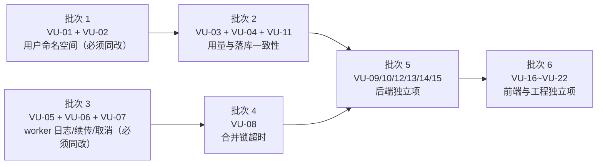

# vane-upload 修复与实施清单

> 分析对象：`E:\vane-upload`（前端 `src/**` + 后端 `server/src/**`）
> 分析日期：2026-11-07
> 本轮性质：只做静态审查与结论输出，**未修改任何源码**
> 分析依据：`vercel-react-best-practices`、`TRAE-code-review`、`TRAE-security-review`、`security-best-practices`（Express / React 两份 reference）
> 结论口径：所有条目均基于当前源码可直接定位的事实；无法只靠源码判定的，标为 **待验证**，不作为结论。

---

## 一、总览

### 1.1 数量

| 级别 | 数量 | 含义 |
| --- | --- | --- |
| P0 | 1 | 可造成跨用户数据丢失，必须最先修 |
| P1 | 7 | 跨租户完整性、可用性、一致性、凭据泄漏，尽快修 |
| P2 | 14 | 健壮性、性能、可维护性、纵深防御 |
| **合计** | **22** | — |

### 1.2 按模块分布

| 模块 | 涉及编号 | 数量 |
| --- | --- | --- |
| 后端 · 文件落盘与路径 | VU-01、VU-02、VU-15 | 3 |
| 后端 · 配额与并发控制 | VU-03、VU-08、VU-11 | 3 |
| 后端 · 数据一致性（SQLite / 落库队列） | VU-04、VU-12、VU-13 | 3 |
| 后端 · 请求体与错误处理 | VU-09、VU-10 | 2 |
| 后端 · 依赖与功能可用性 | VU-14 | 1 |
| 前端 · Worker（上传/哈希） | VU-05、VU-06、VU-07 | 3 |
| 前端 · 组件与 hooks | VU-16、VU-17、VU-20、VU-22 | 4 |
| 前端 · IndexedDB 与队列 | VU-18、VU-19 | 2 |
| 安全 · 鉴权与会话 | VU-21 | 1 |

### 1.3 建议实施顺序（依赖关系）



- **必须一起改**：`VU-01 + VU-02`（同一个“存储键缺少用户维度”的根因，分开改会出现“文件按用户隔离、分片仍全局共享”的半成品）；`VU-03 + VU-04 + VU-11`（共用同一份用量/落库状态）；`VU-05 + VU-06 + VU-07`（同一 worker 文件，需一次回归）。
- **互不影响、可并行**：`VU-08`、`VU-09`、`VU-10`、`VU-12`、`VU-13`、`VU-14`、`VU-15` 之间无代码耦合；前端 `VU-16 ~ VU-22` 与后端全部条目无耦合。
- **建议先做**：`VU-01`（唯一 P0，改动面小、可独立验证、风险最高）。

### 1.4 已验证的基线（避免重复报告）

以下项在源码中已正确处理，本轮**不作为问题**：

- 鉴权默认 `secure` 且 fail-closed，未配置凭据时一律 401；Cookie 分支强制白名单，不存在“有值即通过”（[auth.js](file:///E:/vane-upload/server/src/middleware/auth.js#L73-L113)）。
- `md5` 强制 32 位十六进制、`file_id` 白名单字符、`resolveInsideBase` 二次目录约束（[fileSecurity.js](file:///E:/vane-upload/server/src/utils/fileSecurity.js#L15-L34)）。
- 合并先写 staging，校验体积与全量 md5 后再原子移入目标目录（[uploadController.js](file:///E:/vane-upload/server/src/controllers/uploadController.js#L686-L743)）。
- 5xx 与业务错误分环境脱敏，生产不回传堆栈/路径（[errorMessage.js](file:///E:/vane-upload/server/src/utils/errorMessage.js#L18-L24)）。
- `x-powered-by` 关闭，基础安全响应头、CORS 默认关闭、限流可配（[app.js](file:///E:/vane-upload/server/src/app.js#L10-L61)）。
- 前端 Worker 对鉴权头做宿主白名单校验，非白名单域名不附加 Bearer（[urlSafety.ts](file:///E:/vane-upload/src/shared/urlSafety.ts#L53-L61)、[uploadWorker.ts](file:///E:/vane-upload/src/components/ZustandFileUpload/worker/uploadWorker.ts#L186-L190)）。
- ~~IndexedDB 不持久化整文件，仅登记主线程 `fileRef`~~ —— **因方案 A（分片字节持久化到 `react-upload-chunks`）变更，原结论已失效**：元数据库仍只存元数据，未确认分片改由独立分片缓存持久化，刷新后可零点击续传（[useFileProcessor.ts](file:///E:/vane-upload/src/components/ZustandFileUpload/hooks/useFileProcessor.ts#L246-L261)、[chunkCache.ts](file:///E:/vane-upload/src/components/ZustandFileUpload/services/chunkCache.ts)）。

---

## 二、P0 问题

### VU-01 存储文件名缺少用户维度，合并失败清理路径可删除其他用户的文件

- **严重级别**：P0
- **模块**：后端 · 文件落盘与路径
- **问题描述**：
  `storedFileName` 由 `${safeFileId}_${md5}${ext}` 组成，其中 `safeFileId` 是客户端按内容派生的分片键（`${md5}_${size}_${chunkSize}`），**不含 `userId`**。而数据库行 `file_id` 已经加了用户命名空间（`${userId}:${chunkKey}`），两者不一致。结果是：两个不同用户上传**相同内容**时，落盘路径完全相同。
  更严重的是 `catch` 分支只要 `targetPath` 存在就无条件 `unlink`，并不判断该文件是否由本次请求创建。
- **具体位置**：
  - [uploadController.js#L252-L258](file:///E:/vane-upload/server/src/controllers/uploadController.js#L252-L258) `buildStoredFileName`
  - [uploadController.js#L611-L613](file:///E:/vane-upload/server/src/controllers/uploadController.js#L611-L613) `fileRowId` 已按用户隔离（形成对比）
  - [uploadController.js#L683-L692](file:///E:/vane-upload/server/src/controllers/uploadController.js#L683-L692) `targetPath` / `stagingPath` 计算
  - [uploadController.js#L743-L749](file:///E:/vane-upload/server/src/controllers/uploadController.js#L743-L749) `moveIntoPlace` 与 `file_path` 写入
  - [uploadController.js#L819-L823](file:///E:/vane-upload/server/src/controllers/uploadController.js#L819-L823) 失败清理无条件删除 `targetPath`
- **影响**：跨租户**文件覆盖与数据丢失**。用户 B 的一次失败合并可以让用户 A 已成功落盘的文件消失，且 A 的 DB 行仍指向该路径（后续任何读取都会 404）。
- **触发条件 / 攻击路径**（已认证用户即可，无需管理员）：
  1. A 上传内容 X 成功，落盘 `/uploads/<chunkKey>_<md5>.ext`；
  2. B 持有合法凭据，也知道 X 的内容（同为公开素材/共享文档），按相同 `md5/size/chunkSize` 分片上传；
  3. B 在 `merge` 中故意声明错误的 `size`（或篡改任一分片使 `size/md5` 校验失败）；
  4. 校验失败抛错 → `catch` 执行 → `fs.existsSync(targetPath)` 为真 → 删除 A 的文件。
  该路径不依赖竞态，单次请求即可完成。
- **修复方向**：
  1. 落盘文件名加入用户命名空间，例如 `storedFileName = ${shortHash(userId)}_${safeFileId}_${md5}${ext}`，与 `fileRowId` 口径一致；
  2. 失败清理只在“本请求确实完成过 `moveIntoPlace`”时删除：新增 `movedIntoPlace = false`，成功移动后置 `true`，`catch` 中仅当其为 `true` 才 `unlink(targetPath)`；
  3. 若需兼容历史文件，读取侧按“新名优先、旧名回退”解析，并提供一次性迁移脚本（本轮不实现）。
- **验证方式**：
  - 新增后端用例：用户 A merge 成功 → 用户 B 用同内容 + 错误 `size` merge → 断言返回 4xx 且 A 的文件仍存在、A 的 `instant` 仍返回 `uploaded: true`；
  - 回归：`npm run test:server`（现有 `tenant-isolation.test.js`、`file-api.test.js` 全绿）；
  - 手工：`GET /api/file/status` 前后对比 A 的文件可读性。

---

## 三、P1 问题

### VU-02 分片写入与分片状态查询未按用户隔离，可覆盖或污染他人分片

- **严重级别**：P1
- **模块**：后端 · 文件落盘与路径
- **问题描述**：
  分片路径由 `buildChunkPath(fileId, index)` 生成，仅依赖内容派生的 `fileId`；`FileChunk` 表虽有 `user_id` 列且写入时赋值，但**所有查询都不带 `user_id`**。上传分片时不校验该 `fileId` 是否属于当前用户。
- **具体位置**：
  - [fileSecurity.js#L52](file:///E:/vane-upload/server/src/utils/fileSecurity.js#L52) `buildChunkPath`
  - [uploadController.js#L464-L568](file:///E:/vane-upload/server/src/controllers/uploadController.js#L464-L568) `uploadChunk`（写入路径与配额均只按 `safeFileId`）
  - [uploadController.js#L434-L462](file:///E:/vane-upload/server/src/controllers/uploadController.js#L434-L462) `statusQuery`（`where: { file_id, status: 1 }`）
  - [uploadController.js#L406-L423](file:///E:/vane-upload/server/src/controllers/uploadController.js#L406-L423) `instantCheck` 的分片查询
  - [uploadController.js#L676-L681](file:///E:/vane-upload/server/src/controllers/uploadController.js#L676-L681) `mergeChunks` 的分片查询
- **影响**：跨租户上传完整性破坏。B 可覆盖 A 正在上传的某个分片，使 A 的合并返回 409/422；`status` 还会向 B 泄漏“某内容已上传到第几片”的进度信息。最终文件仍受全量 md5 校验保护，因此不构成“B 写入 A 的文件内容”，但足以造成 A 上传失败与信息泄露。
- **触发条件**：任意已认证用户，知道目标内容（即可算出 `fileId`），向 `/api/file/upload` 提交相同 `file_id` + 任意 `index` 的分片。服务端不校验归属，直接 `writeFile` 覆盖。
- **修复方向**：
  1. 分片存储键与路径统一加用户命名空间（与 VU-01 同一批次），例如 `chunkPath = TMP/<userHash>/<fileId>_<index>`；
  2. `FileChunk` 的所有查询补 `user_id` 过滤（`instant/status/merge/reset/reconcile`）；
  3. 上传分片前校验“该 `fileId` 的进行中会话属于当前用户”，否则 403。
- **验证方式**：新增用例“B 用 A 的 `file_id` 上传分片 → 403/404，且 A 的分片字节未变”；`tenant-isolation.test.js` 增加 `status` 与 `upload` 维度断言；`npm run test:server`。

### VU-03 用量配额为进程内近似计数，并发首访与重启可绕过

- **严重级别**：P1
- **模块**：后端 · 配额与并发控制
- **问题描述**：
  单文件、全局、用户三档配额全部依赖进程内 `Map` 缓存。首次访问时 `seed*` 从磁盘/DB 播种，`await` 期间多个并发请求会各自看到空缓存并各自播种，随后互相覆盖；覆盖写、合并、janitor 删除后只做“失效”，不做精确扣减，长期运行会漂移。进程重启后计数归零（重新播种可恢复磁盘真实值，但播种前的并发窗口仍存在）。
- **具体位置**：
  - [uploadController.js#L113-L182](file:///E:/vane-upload/server/src/controllers/uploadController.js#L113-L182) `chunkUsage` / `globalChunkUsage` / `forgetChunkUsage`
  - [uploadController.js#L184-L224](file:///E:/vane-upload/server/src/controllers/uploadController.js#L184-L224) `userChunkUsage`
  - [uploadController.js#L497-L557](file:///E:/vane-upload/server/src/controllers/uploadController.js#L497-L557) 校验后写盘、再更新计数（非原子）
- **影响**：配额可被并发请求短时突破（同一凭据并行拉多个 `file_id` 同时备战），磁盘占用超过配置上限；计数漂移还会导致正常用户被误拒。
- **触发条件**：同一凭据并发发起多个首次分片请求（每个新 `file_id` 都会触发一次播种），或在播种完成前并发写入。
- **修复方向**：把“播种 + 校验 + 记账”串到同一把异步互斥（按 `fileId` / `userId` / `global` 三级 key），并在写盘前预留额度、失败回滚；长期应改为以 DB 聚合为权威（`FileChunk` 按 `user_id` 求和）。
- **验证方式**：新增并发用例（`Promise.all` 并发 20 个首次分片请求，总字节超限）→ 断言超限请求全部 413，磁盘总量不超过上限；`user-quota.test.js` 补充并发分支。

### VU-04 分片状态异步批量落库，崩溃窗口造成 DB 与磁盘不一致

- **严重级别**：P1
- **模块**：后端 · 数据一致性
- **问题描述**：
  分片文件先 `writeFile` 成功，再把分片状态放进内存队列，由定时器/批量刷盘写入 `FileChunk`。进程在“已落盘、未刷库”窗口内退出时，磁盘有分片、DB 无记录；重启后内存队列为空，`merge` 因 `dbChunk` 缺失直接 400（“chunk i not found in database”），客户端必须重传全部分片。
- **具体位置**：
  - [uploadController.js#L551-L566](file:///E:/vane-upload/server/src/controllers/uploadController.js#L551-L566) 写盘后 `enqueueChunkState`
  - [chunkStateQueue.js#L150-L166](file:///E:/vane-upload/server/src/services/chunkStateQueue.js#L150-L166) 入队与批量触发
  - [chunkStateQueue.js#L168-L206](file:///E:/vane-upload/server/src/services/chunkStateQueue.js#L168-L206) 刷盘
  - [uploadController.js#L695-L707](file:///E:/vane-upload/server/src/controllers/uploadController.js#L695-L707) 合并时强依赖 DB 行
- **影响**：异常重启后，已上传的大文件无法续传/合并，用户侧表现为“上传完成却合并失败”，且需全量重传。属可用性与数据一致性问题，非安全漏洞。
- **触发条件**：进程崩溃、容器被 kill、部署滚动重启恰好落在刷盘间隔（默认 180ms 或 40 条批量）内。
- **修复方向**：合并时允许“磁盘存在分片但 DB 无行”的情况，以磁盘 + 客户端传入的分片 md5 重建最小状态；或把 `chunk_md5` 写入分片旁路元数据文件；更彻底的做法是分片落盘与状态写入同一事务边界（先写临时名、刷库成功后再 rename）。
- **验证方式**：新增用例：写盘后清空队列缓存并重建模块状态（模拟重启）→ `merge` 应成功或给出可续传的 4xx 而非 500/不可恢复 400；回归 `chunk-key.test.js`、`file-api.test.js`。

### VU-05 Worker 调试日志输出完整请求头，含 Authorization 凭据

- **严重级别**：P1
- **模块**：前端 · Worker
- **问题描述**：
  `fetchWithRetry` 在 debug 分支把 `mergedHeaders` 整体 `JSON.stringify` 后写入日志，其中包含 `Authorization: Bearer <token>`。调试开关由组件 `debug` prop 打开，日志会进入 worker 的 `console` 与 `debugLogger` 环形缓冲。
- **具体位置**：
  - [uploadWorker.ts#L248-L252](file:///E:/vane-upload/src/components/ZustandFileUpload/worker/uploadWorker.ts#L248-L252)
  - [debugLogger.ts#L53-L56](file:///E:/vane-upload/src/shared/debugLogger.ts#L53-L56)（环形缓冲）
  - [debugLogger.ts#L70-L71](file:///E:/vane-upload/src/shared/debugLogger.ts#L70-L71) `getDebugLog()` 对外导出（[index.ts](file:///E:/vane-upload/src/index.ts)）
- **影响**：开启 `debug` 后，任何能读取控制台/调试日志的人（共享终端、录屏、用户自助导出日志、埋点转发）都能拿到长期有效的 Bearer token。
- **触发条件**：宿主开启 `debug` → 任一次分片/合并请求 → 日志打印 headers。
- **修复方向**：日志中对请求头做脱敏白名单，仅保留 `Content-Type` 等非敏感键；对 `Authorization`/`Cookie`/`X-*Token*` 统一替换为 `***`；`getDebugLog()` 输出前再做一次正则脱敏（双保险）。
- **验证方式**：新增单测：`debug=true` 发起一次带 `authHeaders` 的请求 → 断言捕获的日志字符串不包含 token 原文；`npm test -- uploadWorker`。

### VU-06 秒传预检失败即跳过 `/status`，断点续传在瞬断后退化为全量重传

- **严重级别**：P1
- **模块**：前端 · Worker
- **问题描述**：
  `existingChunks` 的查询被包在 `if (fastData)` 里。预检（`/instant`）只要因网络抖动返回 `null`，即使后续网络恢复，也不会再查 `/status`，`needUploadChunks` 变成“全部分片”，已经上传成功的分片全部重传。对大文件而言是明显的带宽与时间浪费，也让“断点续传”这一核心能力在弱网下失效。
- **具体位置**：
  - [uploadWorker.ts#L502-L546](file:///E:/vane-upload/src/components/ZustandFileUpload/worker/uploadWorker.ts#L502-L546) 预检与失败吞掉
  - [uploadWorker.ts#L551-L585](file:///E:/vane-upload/src/components/ZustandFileUpload/worker/uploadWorker.ts#L551-L585) `if (fastData)` 包裹状态查询
- **影响**：弱网/服务端短暂 5xx 时，续传退化为重传，用户体验与成本受损；不影响最终正确性。
- **触发条件**：`/instant` 首次请求超时或被重试耗尽（`fetchWithRetry` 捕获后返回 `null`）。
- **修复方向**：状态查询与预检解耦，失败时仍尝试 `/status`；只在“预检 + 状态查询都失败”时才全量重传。可把 `fastData` 仅用于秒传短路判断。
- **验证方式**：单测 mock `/instant` 抛错、`/status` 返回 `[0,1,2]` → 断言只上传缺失分片；现有 `uploadWorker.p2-1.test.ts` 增补该用例。

### VU-07 取消上传与错误上报存在竞态，UI 可能显示“失败”而非“已取消”

- **严重级别**：P1
- **模块**：前端 · Worker
- **问题描述**：
  取消时分片 fetch 抛 `AbortError`，worker 内层 `catch` 先 `postMessage({ type: "error", message: "上传已取消" })`；主线程的 `handleAbort` 同时会 `finish(cancelled)` 并销毁 worker。两者谁先到取决于消息时序，因此“取消”有时被渲染成失败状态，并可能触发 `onUploadError`。
- **具体位置**：
  - [uploadWorker.ts#L232-L242](file:///E:/vane-upload/src/components/ZustandFileUpload/worker/uploadWorker.ts#L232-L242) 取消联动
  - [uploadWorker.ts#L775-L783](file:///E:/vane-upload/src/components/ZustandFileUpload/worker/uploadWorker.ts#L775-L783) 致命错误统一上报 `error`
  - [uploadWorkerBridge.ts#L232-L253](file:///E:/vane-upload/src/components/ZustandFileUpload/services/uploadWorkerBridge.ts#L232-L253) 主线程 `handleAbort`
- **影响**：用户主动取消被记为失败，错误提示/统计失真；重试逻辑可能对已取消任务再次发起请求。
- **触发条件**：在分片下载/上传在途时点击取消（大文件、弱网下概率更高）。
- **修复方向**：worker 内统一判定——若 `signal.aborted` 或错误为 `AbortError`，改为 `postMessage({ type: "cancelled" })` 而不是 `error`；主线程以 `cancelled` 为唯一取消语义。
- **验证方式**：`uploadWorker.cancel.test.ts` 增加“在途 fetch 被 abort”用例，断言收到 `cancelled` 且未收到 `error`；`npm test`。

### VU-08 合并锁等待无超时，单个慢合并可无限阻塞同键请求

- **严重级别**：P1
- **模块**：后端 · 配额与并发控制
- **问题描述**：
  发现同键合并进行中时直接 `await inFlight.promise`，没有超时与队列上限。该 Promise 只在 `finally` 里 `release()` 时兑现；若首个合并卡在磁盘 IO（大文件 `appendFile`、`md5File`）或数据库重试，所有后续同键请求会一直挂起，连接与内存持续累积。
- **具体位置**：
  - [uploadController.js#L226-L241](file:///E:/vane-upload/server/src/controllers/uploadController.js#L226-L241) `mergeLocks`
  - [uploadController.js#L646-L660](file:///E:/vane-upload/server/src/controllers/uploadController.js#L646-L660) 等待在途合并
  - [uploadController.js#L839-L848](file:///E:/vane-upload/server/src/controllers/uploadController.js#L839-L848) `finally` 释放
- **影响**：可用性。单个慢请求可把同内容的所有合并请求挂住，且 `mergeKey` 不含 `userId`，不同用户也会互相阻塞。
- **触发条件**：大文件合并（GB 级）+ 客户端重试/多用户上传相同内容。
- **修复方向**：等待加超时（如 30s）并在超时后返回 503 + `Retry-After`；`mergeKey` 加 `userId` 维度；对等待者数量设上限，超出直接 429/503。
- **验证方式**：单测注入一个永不 resolve 的合并（mock `md5File`），并发第二个请求 → 断言在配置超时内返回 503；`hardening.test.js` 增补。

---

## 四、P2 问题

### VU-09 `express.json` 允许 20MB 且在鉴权前解析，`instantCheck` 保留无上限的 `chunk_md5s`

- **严重级别**：P2
- **模块**：后端 · 请求体
- **位置**：[app.js#L43-L44](file:///E:/vane-upload/server/src/app.js#L43-L44)；[uploadController.js#L370](file:///E:/vane-upload/server/src/controllers/uploadController.js#L370)、[#L406-L423](file:///E:/vane-upload/server/src/controllers/uploadController.js#L406-L423)
- **问题**：`express.json({ limit: "20mb" })` 挂载在鉴权中间件之前，未认证请求也会先分配解析缓冲；`instantCheck` 仍支持 `chunk_md5s` 数组（前端 P2-1 改造后已不再发送），数组长度无上限，逐项 `map` 生成结果。
- **影响**：无效内存占用与解析开销；该能力已成为死代码但保留攻击面。
- **修复方向**：把 `json` 解析挂到 `/api/file` 鉴权之后，或对该路由单独设更小限制（如 1MB）；删除 `chunk_md5s` 分支，或限制数组长度 ≤ `MAX_CHUNKS` 并做类型校验。
- **验证方式**：新增用例：未带凭据的超大 body → 401 且不进入解析；`chunk_md5s` 超长 → 400。回归 `hardening.test.js`。

### VU-10 multer 超限错误被映射为 500，并触发客户端 5xx 重试

- **严重级别**：P2
- **模块**：后端 · 错误处理
- **位置**：[uploadChunk.js#L13-L20](file:///E:/vane-upload/server/src/middleware/uploadChunk.js#L13-L20)；[app.js#L127-L144](file:///E:/vane-upload/server/src/app.js#L127-L144)
- **问题**：`multer` 的 `LIMIT_FILE_SIZE` 等 `MulterError` 未被识别，落到统一 `errorHandler` 返回 500；客户端 `fetchWithRetry` 对 5xx 会重试，导致确定性的失败被重复发送。
- **影响**：错误码语义错误（应为 413/400），客户端无意义重试与日志噪声。
- **修复方向**：在 `errorHandler` 或路由层识别 `error.name === "MulterError"`，映射 `LIMIT_FILE_SIZE → 413`、其余 → 400，并返回结构化 `code`。
- **验证方式**：`supertest` 发送超过 `CHUNK_MAX_SIZE_MB` 的分片 → 断言 413、响应体含 `maxMb`。

### VU-11 用量缓存失效后触发全目录 `stat` 扫描

- **严重级别**：P2
- **模块**：后端 · 性能
- **位置**：[uploadController.js#L120-L162](file:///E:/vane-upload/server/src/controllers/uploadController.js#L120-L162)；[#L178-L182](file:///E:/vane-upload/server/src/controllers/uploadController.js#L178-L182)
- **问题**：`forgetChunkUsage` 把 `globalChunkUsage.seeded = false`，下一次分片请求会 `readdir` + 逐文件 `stat` 整个 tmp 目录。合并/重置越频繁，扫描越频繁（O(文件数) I/O）。
- **影响**：大目录下分片请求延迟抖动，与 VU-03 的计数漂移互相放大。
- **修复方向**：改为增量记账（合并/删除时精确扣减），仅在进程启动时播种一次；或按目录分桶统计。
- **验证方式**：构造 1 万个小分片文件，压测连续 merge → 断言无重复全量扫描日志、P95 延迟稳定（可用现有 `janitor`/控制器测试改造为基准）。

### VU-12 SQLite 依赖 `sequelize.sync()`，无迁移机制

- **严重级别**：P2
- **模块**：后端 · 数据一致性
- **位置**：[models/index.js#L20-L22](file:///E:/vane-upload/server/src/models/index.js#L20-L22)；[index.js#L8-L11](file:///E:/vane-upload/server/src/index.js#L8-L11)
- **问题**：`sync()` 默认 `alter: false`，新增列/索引不会应用到已存在的库；当前 `server/data/indexeddb-upload.sqlite` 已在仓库中，后续模型演进会静默失效。
- **影响**：升级后出现“代码有字段、表没有”的运行时错误，且难以从代码判断线上表结构。
- **修复方向**：引入 `sequelize-cli`/`umzug` 迁移目录，启动时执行待应用迁移；`sync()` 仅用于测试内存库。
- **验证方式**：新增迁移并在空库 + 旧库两种场景启动 → 断言表结构一致；`npm run test:server`。

### VU-13 `sqlite3Adapter` 参数绑定多路回退可能掩盖真实错误

- **严重级别**：P2
- **模块**：后端 · 可维护性
- **位置**：[sqlite3Adapter.js#L16-L57](file:///E:/vane-upload/server/src/utils/sqlite3Adapter.js#L16-L57)；[#L59-L85](file:///E:/vane-upload/server/src/utils/sqlite3Adapter.js#L59-L85)
- **问题**：`applyStatement` 在命名参数绑定失败后会尝试 `$n` 归一化、再尝试有序数组，最终才抛出**第一个**错误；`normalizeQuery` 对缺失参数静默填 `undefined`。真实 SQL/绑定错误容易被后续尝试掩盖。
- **影响**：排障成本高；参数缺失时可能以 `NULL` 静默执行，产生难以察觉的数据偏差。
- **修复方向**：只保留 Sequelize 实际使用的一种绑定形式；缺失 `$n` 参数直接抛错；把回退尝试降级为开发期断言。
- **验证方式**：新增单测：故意缺参 → 断言抛出明确错误而非静默执行；现有后端用例全绿。

### VU-14 `sharp` 未声明依赖、`mime-types` 未使用，缩略图能力永远不可用

- **严重级别**：P2
- **模块**：后端 · 依赖与功能
- **位置**：[thumbnail.js#L1-L12](file:///E:/vane-upload/server/src/utils/thumbnail.js#L1-L12)；[server/package.json#L15-L25](file:///E:/vane-upload/server/package.json#L15-L25)
- **问题**：`generateThumbnail` 动态 `import("sharp")`，但 `sharp` 不在 `dependencies`；异常被控制器 `catch` 后 `thumbnailPath = null`，因此图片缩略图功能实际永不生效且无任何提示。`mime-types` 在源码中无引用。
- **影响**：能力缺失被静默吞掉；多一个无人使用的依赖（供应链面）。
- **修复方向**：要么把 `sharp` 声明为可选依赖（`optionalDependencies`）并在缺失时输出一次性 warn，要么删除缩略图分支与 `mime-types` 依赖。
- **验证方式**：`npm ls sharp mime-types`；上传图片后断言 `thumbnail_path` 行为与文档一致（要么生成、要么明确日志）。

### VU-15 janitor 仅按 mtime 清理，可能误删长期暂停或正在合并的文件（待验证）

- **严重级别**：P2
- **模块**：后端 · 文件清理
- **位置**：[janitor.js#L24-L56](file:///E:/vane-upload/server/src/janitor.js#L24-L56)；[#L62-L112](file:///E:/vane-upload/server/src/janitor.js#L62-L112)
- **问题**：扫描 tmp 目录时只判断 `now - mtime > ttl`，命中即删，不区分分片、合并 staging（`*.part`）与正在被使用的文件。`PROTECTED_FILES` 只保护 `.gitkeep`。
- **影响**：超过 TTL 的暂停任务分片会被清除（续传静默失败）；极端情况下合并耗时长于 TTL 时 staging 被删，合并中途失败。
- **待验证**：暂停语义下是否允许跨 TTL 续传、合并最长耗时是否可能超过 `TMP_TTL_HOURS`，需要运行期/产品口径确认。
- **修复方向**：按文件名区分分片与 staging；对 `*.part` 采用更短且独立的 TTL，并在合并开始时更新 mtime；或维护“活跃合并”集合，扫描时跳过。
- **验证方式**：单测构造 `mtime` 超 TTL 的 `.part` 与分片，断言按预期分类处理；`janitor.test.js` 增补。

### VU-16 `UploadProvider` 在渲染期创建并写入 ref，context value 未 memo，`instanceId` 变更不生效

- **严重级别**：P2
- **模块**：前端 · 组件与 hooks
- **位置**：[UploadContext.tsx#L100-L121](file:///E:/vane-upload/src/components/ZustandFileUpload/context/UploadContext.tsx#L100-L121)；[#L123-L157](file:///E:/vane-upload/src/components/ZustandFileUpload/context/UploadContext.tsx#L123-L157)
- **问题**：`if (engineRef.current === null) { 创建 engine }` 在 render 阶段执行副作用（创建 storage/worker/store），违反 React 的 render 纯函数约束；`value` 每次渲染都是新对象，任何父组件重渲染都会让全部消费者重渲染；`instanceId` 变化不会重建引擎，导致实例隔离失效。
- **影响**：可预测性差（未来开启 StrictMode/并发渲染时可能重复创建资源）；列表/进度更新时不必要的全树重渲染；多实例切换场景下数据串用。
- **修复方向**：用 `useState(() => createEngine(instanceId))` 做惰性初始化，并以 `instanceId` 作为 `key` 或显式重建条件；`value` 用 `useMemo` 包裹（依赖项逐一列出）。
- **验证方式**：`uploadEngine.isolation.test.tsx` 增加“父组件重渲染 → 子组件 render 次数不变”与“instanceId 变化 → 引擎重建”用例。

### VU-17 `useFileProcessor` 以文件名做计时键，卸载时 pending Promise 不 settle

- **严重级别**：P2
- **模块**：前端 · 组件与 hooks
- **位置**：[useFileProcessor.ts#L182-L190](file:///E:/vane-upload/src/components/ZustandFileUpload/hooks/useFileProcessor.ts#L182-L190)；[#L202-L309](file:///E:/vane-upload/src/components/ZustandFileUpload/hooks/useFileProcessor.ts#L202-L309)
- **问题**：`fileStartTimesRef` 以 `file.name` 为 key，同名文件（不同目录）互相覆盖，`fileTimings` 记录错位。卸载时 cleanup 直接 `terminate()` 并清空 `onmessage`，而 `await new Promise(...)` 既不会 resolve 也不会 reject，`handleFileChange` 永久挂起。
- **影响**：耗时统计失真；组件卸载后的异步函数残留（闭包与引用不释放）。
- **修复方向**：计时键改为 `name + size + lastModified` 或临时 id；cleanup 中显式 `resolve()`（带“已取消”语义）或让 Promise 接受 `AbortSignal`。
- **验证方式**：单测：两个同名不同大小文件 → 断言 timings 各自独立；预处理中卸载组件 → 断言无未处理挂起（可用 fake timers 与 spy 校验）。

### VU-18 上传过程中每 120ms 全量读取并排序 IndexedDB

- **严重级别**：P2
- **模块**：前端 · 存储与性能
- **位置**：[uploadStorage.ts#L11-L25](file:///E:/vane-upload/src/components/ZustandFileUpload/services/uploadStorage.ts#L11-L25)；[useUploaderLifecycle.ts#L80-L92](file:///E:/vane-upload/src/components/ZustandFileUpload/hooks/useUploaderLifecycle.ts#L80-L92)
- **问题**：`refreshFiles` 每次都 `storage.iterate` 全量记录 + `sort`，而进度更新会周期性调度 refresh（默认 120ms 节流）。文件多、记录大时，主线程与 IDB 压力随上传时长线性累积。
- **影响**：低配设备上传时掉帧、进度显示滞后；与 React 重渲染叠加更明显。
- **修复方向**：进度更新走内存 store，不写 IDB；仅在状态变更（完成/失败/删除）时落库并刷新；刷新时只取变更的 key（`storage.keys()` + 差值）。
- **验证方式**：`uploadStorage.test.ts` 增补“多次进度更新不触发全量 iterate”的 spy 断言；浏览器 Performance 面板对比上传期间主线程占用。

### VU-19 重复添加同一文件会生成多条队列记录

- **严重级别**：P2
- **模块**：前端 · 队列
- **位置**：[filePrepareWorker.ts#L154-L176](file:///E:/vane-upload/src/components/ZustandFileUpload/worker/filePrepareWorker.ts#L154-L176)（`buildQueueId` 含随机后缀）；[useFileProcessor.ts#L246-L261](file:///E:/vane-upload/src/components/ZustandFileUpload/hooks/useFileProcessor.ts#L246-L261)
- **问题**：队列 id 刻意包含随机后缀以避免同内容互相覆盖，但没有“已存在则跳过/合并”的判断，同一文件可被反复加入队列，各自显示进度并各自触发一次服务端秒传。
- **影响**：列表冗余、无谓请求；`maxFiles` 也可能被同类重复项快速占满。
- **修复方向**：入队前按 `hash + size + lastModified` 去重（已存在则提示并跳过），或复用已有记录并重置状态。
- **验证方式**：单测连续选择同一文件两次 → 断言队列长度仍为 1；`index.simple.test.tsx` 增补。

### VU-20 ESLint 关闭了 `react-hooks` v7 新规则，effect 内 setState 等回归不可见

- **严重级别**：P2
- **模块**：前端 · 工程基线
- **位置**：[eslint.config.js](file:///E:/vane-upload/eslint.config.js)（`rules-of-hooks` + `exhaustive-deps` 之外全部关闭）；现存违规点：[BatchInfoDisplay.tsx#L49](file:///E:/vane-upload/src/components/ZustandFileUpload/components/BatchInfoDisplay.tsx#L49)、[StorageStatsDrawer.tsx#L35](file:///E:/vane-upload/src/components/ZustandFileUpload/components/StorageStatsDrawer.tsx#L35)、[feedback.tsx](file:///E:/vane-upload/src/ui/feedback.tsx)
- **问题**：为绕过迁移期报错，关闭了 `react-hooks/set-state-in-effect`、`refs` 等新规则；组件里确实存在 render/effect 期读写 ref 与 effect 内同步 setState 的写法，后续同类问题不再被静态发现。
- **影响**：React 19 并发特性下的正确性风险长期不可见，只能靠人工审查。
- **修复方向**：逐项修复现有违规（派生 state 改为 render 期计算、effect 内 setState 改为事件驱动/`useSyncExternalStore`），然后重新启用规则并保持 `error`。
- **验证方式**：启用规则后 `npm run lint` 全绿；`npm test` 无回归。

### VU-21 Cookie 鉴权下缺少 CSRF 防护与 SameSite 约定（待验证）

- **严重级别**：P2
- **模块**：安全 · 鉴权与会话
- **位置**：[auth.js#L93-L108](file:///E:/vane-upload/server/src/middleware/auth.js#L93-L108)；[app.js#L25-L41](file:///E:/vane-upload/server/src/app.js#L25-L41)
- **问题**：服务端接受 Cookie 作为凭据，`/api/file/upload|merge` 是状态变更接口，但没有 CSRF token、Origin 校验或双提交 Cookie；CORS 在配置白名单时开启了 `credentials: true`。Cookie 的 `SameSite` 由部署方设置，仓库内无法确认。
- **影响**：若部署时 Cookie 为 `SameSite=None`（跨站场景常见），第三方站点可诱导已登录用户发起跨站上传/合并请求，造成存储占用与队列噪声。
- **待验证**：实际部署的 Cookie 属性（`SameSite`/`Secure`/`Domain`）不在本仓库内，无法从源码断言可利用性；若为 `Lax/Strict`，浏览器默认拦截跨站 POST，本条降级为“建议”。
- **修复方向**：对 Cookie 鉴权分支增加 `Origin`/`Referer` 同源校验（或 CSRF token）；文档中明确要求 `SameSite=Lax/Strict`，跨站场景改用 Bearer。
- **验证方式**：在 `auth-cookie-*.test.js` 中增加“跨站 Origin + 有效 Cookie → 403”的用例（若采用 Origin 校验方案）。

### VU-22 未启用 React.StrictMode，缺少开发期双调用检查

- **严重级别**：P2
- **模块**：前端 · 工程基线
- **位置**：[main.tsx#L1-L4](file:///E:/vane-upload/src/main.tsx#L1-L4)
- **问题**：入口直接 `render(<App />)`，没有 `StrictMode`，因此 effect 双调用、render 期副作用等问题在开发环境不会被暴露（VU-16 这类问题正是 StrictMode 的典型捕获对象）。
- **影响**：开发期发现问题的能力下降，问题更容易流入生产。
- **修复方向**：开发环境用 `<StrictMode>` 包裹；同时按 VU-16 修复 render 期副作用，避免 StrictMode 下资源重复创建。
- **验证方式**：开启后 `npm run dev` 手工走一遍选择→上传→暂停→取消→刷新恢复，控制台无重复请求/重复告警。

---

## 五、实施进度表

> 状态取值：待修复 / 修复中 / 已完成。修复时逐条回填，并在“备注”记录对应 commit 或验证命令结果。

| 编号 | 标题 | 级别 | 状态 | 备注 |
| --- | --- | --- | --- | --- |
| VU-01 | 存储文件名缺少用户维度，失败清理可删除他人文件 | P0 | 待修复 | 与 VU-02 同批 |
| VU-02 | 分片写入/状态查询未按用户隔离 | P1 | 待修复 | 与 VU-01 同批 |
| VU-03 | 配额为进程内近似计数，可并发绕过 | P1 | 待修复 | 与 VU-04、VU-11 同批 |
| VU-04 | 分片状态异步落库，崩溃窗口不一致 | P1 | 待修复 | 与 VU-03 同批 |
| VU-05 | Worker 调试日志输出 Authorization | P1 | 待修复 | 与 VU-06、VU-07 同批 |
| VU-06 | 预检失败即跳过 status，续传退化 | P1 | 待修复 | 与 VU-05、VU-07 同批 |
| VU-07 | 取消与错误上报竞态 | P1 | 待修复 | 与 VU-05、VU-06 同批 |
| VU-08 | 合并锁等待无超时 | P1 | 待修复 | 独立 |
| VU-09 | 20MB JSON 在鉴权前解析 + chunk_md5s 无上限 | P2 | 待修复 | 独立 |
| VU-10 | multer 超限被映射为 500 | P2 | 待修复 | 独立 |
| VU-11 | 用量缓存失效后全目录 stat 扫描 | P2 | 待修复 | 与 VU-03 同批 |
| VU-12 | SQLite 无迁移机制 | P2 | 待修复 | 独立 |
| VU-13 | sqlite3Adapter 多路回退掩盖错误 | P2 | 待修复 | 独立 |
| VU-14 | sharp 未声明、mime-types 未使用 | P2 | 待修复 | 独立 |
| VU-15 | janitor 按 mtime 误删风险（待验证） | P2 | 待修复 | 需先确认暂停语义 |
| VU-16 | UploadProvider render 期建引擎 / context 未 memo | P2 | 待修复 | 独立 |
| VU-17 | 计时键用文件名 / 卸载挂起 | P2 | 待修复 | 独立 |
| VU-18 | 每 120ms 全量读 IDB 并排序 | P2 | 待修复 | 独立 |
| VU-19 | 重复添加同文件生成多条记录 | P2 | 待修复 | 独立 |
| VU-20 | ESLint 关闭 react-hooks 新规则 | P2 | 待修复 | 需与相关组件修复同步 |
| VU-21 | Cookie 鉴权缺 CSRF 防护（待验证） | P2 | 待修复 | 依赖部署形态确认 |
| VU-22 | 未启用 StrictMode | P2 | 待修复 | 建议在 VU-16 之后 |

---

## 六、验证命令速查

```powershell
# 类型与静态检查
npm run typecheck
npm run lint

# 前端单测（Vitest）
npm test

# 后端单测（node:test + supertest）
npm run test:server

# 构建
npm run build
```

修复每一批后至少执行：对应包的测试 + `npm run typecheck`；涉及鉴权/路径的批次（VU-01、VU-02、VU-21）额外执行 `npm run test:server` 全量。
